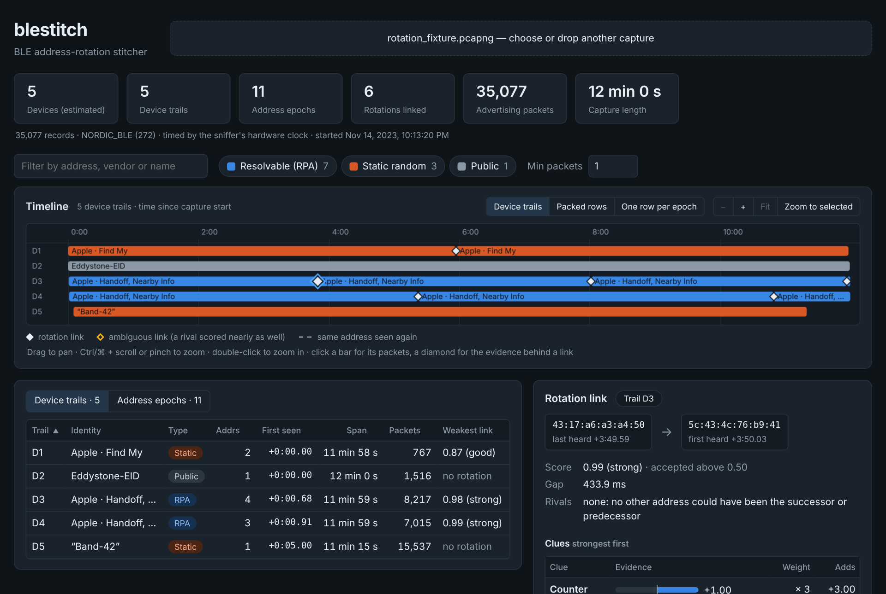

# blestitch

Bluetooth LE devices change their advertising address every few minutes so
they cannot be followed. **blestitch takes a passive radio capture and works
out which of those temporary addresses belong to the same device**, then shows
each device as one continuous trail, with the evidence for every link.



*The app on a synthetic test capture: five devices, eleven addresses, six
address changes linked.*

> **Scope.** Built for a controlled setting with consenting participants and
> devices. A sniffer hears every BLE device in range, so record where only
> consenting devices are nearby, and keep captures private.

## Quick start

You need **Python 3.11+** and **Node.js 18+**. On macOS or Linux:

```bash
git clone https://github.com/PranavKon/blestitch.git
cd blestitch
scripts/setup.sh     # once: installs everything and builds the GUI
scripts/run.sh       # starts the app and opens http://localhost:8000
```

Drop a `.pcapng` capture onto the page. No capture yet? Fetch public samples
with `.venv/bin/python scripts/fetch_samples.py` and use
`data/nrf_sniffer_sterzo.pcapng`.

On Windows, follow [Manual setup](#manual-setup) instead.

## Scripts

| Command | What it does |
|---|---|
| `scripts/setup.sh` | One-time setup: Python environment, dependencies, GUI build. Safe to re-run. |
| `scripts/run.sh` | Start the app on http://localhost:8000 and open the browser. `PORT=9000` changes the port. |
| `scripts/capture.sh [name]` | Record from an nRF Sniffer dongle into `data/`, keeping a Mac awake meanwhile. |
| `.venv/bin/blestitch FILE` | Stitch a capture in the terminal, no browser. `--json out.json` saves the full result. |
| `scripts/dev.sh` | For changing the code: backend and GUI with live reload, on http://localhost:5173. |
| `scripts/check.sh` | Tests, lint and GUI build, as run before sharing a change. |
| `scripts/fetch_samples.py` | Download public sample captures into `data/`. |

## Recording a capture

You need an [nRF52840 Dongle](https://www.nordicsemi.com/Products/Development-hardware/nRF52840-Dongle)
running Nordic's sniffer firmware, and Nordic's
[`nrfutil`](https://www.nordicsemi.com/Products/Development-tools/nRF-Util).

**One-time dongle setup**

```bash
nrfutil install ble-sniffer device
nrfutil ble-sniffer bootstrap        # downloads firmware, adds the sniffer to Wireshark
nrfutil device list                  # note the dongle's serial number
```

Put the dongle in bootloader mode (press RESET; the red LED pulses), then:

```bash
nrfutil device program --serial-number <SERIAL> \
  --firmware ~/.nrfutil/share/nrfutil-ble-sniffer/firmware/sniffer_nrf52840dongle_nrf52840_<VERSION>.zip
```

**Each capture**

```bash
scripts/capture.sh my-capture        # Ctrl+C to stop; writes data/my-capture.pcap
```

Or capture in Wireshark on the "nRF Sniffer for Bluetooth LE" interface and
save as pcapng. Either way:

- **Leave the sniffer scanning all devices.** Do not pick one device to follow.
- **Record 35–40 minutes.** Addresses rotate about every 15 minutes; you want
  each device to rotate at least twice.
- **Keep the computer awake.** A sleeping Mac cuts power to the dongle and
  ends the capture after a few idle minutes. `scripts/capture.sh` prevents
  this; with Wireshark, run `caffeinate -dims` in a terminal alongside.
- **Write down what was there**: which devices, and the time of anything you
  did (switching a device on, toggling Bluetooth). Without notes there is no
  way to check whether a link is right.

Everything in `data/` is ignored by git. Captures contain real device
addresses and sometimes names, so they are never committed.

## Reading the results

- **Timeline.** One row per device trail, one bar per address, coloured by
  address type. Drag to pan; hold Ctrl or ⌘ and scroll to zoom.
- **Diamonds** sit where a trail changed address. A filled diamond is a link;
  a hollow amber one is *ambiguous*, meaning another pairing fits about as
  well. Click one to see which clues linked the two addresses and how much
  each contributed.
- **Trail names.** `D3` is a device with one trail. `D3a` and `D3b` are two
  trails judged to be the same device using two addresses at once.
- **Tables** list trails and individual addresses. Click a trail for its chain
  of addresses, or an address for its cadence, signal strength, decoded
  payloads (with changed bytes highlighted) and packets.
- **The summary line** shows how much of the file was used: packets that
  failed the sniffer's CRC check or belonged to a connection are counted and
  left out.

In the terminal:

```console
$ .venv/bin/blestitch data/nrf_sniffer_sterzo.pcapng
nrf_sniffer_sterzo.pcapng: 7.6 s, 1,305 records, NORDIC_BLE (272)
Not used: 7 failed CRC, 662 connection-data
1 device (estimated) · 1 trail · 1 address epoch · 0 rotations linked

TRAIL  TYPE    ADDRS  FIRST SEEN  SPAN   PACKETS  WEAKEST LINK  IDENTITY
D1     static      1  +0:00       7.6 s      573  -             “STERZO”
```

## How far to trust it

- **Scores are not probabilities.** The matcher uses fixed rules and weights.
  A score ranks links and explains them; it has not been measured against
  ground truth. Measuring accuracy needs the devices' identity keys and is
  planned (see `PLAN.md`, v2).
- **The device count is an estimate, and runs high.** Addresses of one device
  that share no content are not grouped together.
- **Signal strength counts for a lot.** It separates devices well when nothing
  moves, and less well when people carry them around.
- **Extended advertising (Bluetooth 5)** is only partly read: a packet is used
  when it carries the advertiser's address itself.

## How it works

```
capture → packets → address epochs → clues → matcher → solver → device trails
```

An *epoch* is one address's stretch of packets. For every pair "address A
went quiet, address B appeared", the matcher weighs six clues:

| Clue | What it checks |
|---|---|
| timing | B was first heard soon after A's last packet, judged against how often the device was being heard at all |
| structure | the advertisement is laid out the same way |
| cadence | the advertising interval is the same |
| signal | signal strength just before and just after matches |
| carryover | payload content survived the change (a name, an AirPlay address, a service-data blob), discounted by how many other devices send the same thing |
| counter | a rolling counter (Apple Handoff, Eddystone-TLM, MiBeacon) continues |

Each clue gives evidence from −1 to +1, multiplied by a fixed weight. A solver
then picks links **jointly**, with one successor and one predecessor per
address, so that several devices rotating at the same instant are resolved
together. Two further rules:

- **Re-identification.** A device that goes quiet and returns later under a
  new address is still linked if both addresses carry the same identifying
  content that no other address was sending.
- **Sibling trails.** Trails on air together, at the same signal strength,
  sending identical such content are one device using two addresses at once.

## What it reads

- **Files:** `.pcap` and `.pcapng`, optionally gzip-compressed.
- **Link types:** nRF Sniffer (272, protocol versions 1–3),
  `BLUETOOTH_LE_LL_WITH_PHDR` (256), and bare `BLUETOOTH_LE_LL` (251, which
  records no channel or signal strength).
- **Timing:** nRF Sniffer packets are timed by the sniffer's hardware clock.
- **Payloads:** standard advertising fields, Bluetooth SIG company and service
  names, Apple Continuity (Nearby Info, Handoff, Proximity Pairing, Find My,
  AirPlay, iBeacon), Eddystone, Exposure Notification, Fast Pair, Tile,
  MiBeacon. Apple's formats are undocumented; decoding follows published
  reverse engineering, and the raw bytes are always shown.

## Project layout

```
blestitch/      the engine: a plain Python library with no GUI dependencies
  io/           capture reader
  dissect/      packet and payload decoding, epochs, per-epoch profiles
  features/     per-epoch features and the six clues
  link/         matcher, solver, sibling grouping
  results/      the JSON result the GUI and CLI consume
  cli.py        the `blestitch` command
backend/        FastAPI server: runs the engine, serves the GUI
frontend/       React GUI (canvas timeline)
scripts/        setup, run, capture, dev, check, sample download
tests/          pytest suite on hand-built packets
data/           your captures (ignored by git)
```

`PLAN.md` has the roadmap, the design decisions, and what real captures have
shown so far.

## Development

```bash
scripts/dev.sh       # live reload for both halves
scripts/check.sh     # tests + lint + GUI build
```

Tests build their own packets, so they need no hardware. A few extra tests
run against public sample captures and skip unless you have fetched them with
`scripts/fetch_samples.py`.

## Manual setup

What the scripts do, for Windows or if you prefer to run the steps yourself:

```bash
python -m venv .venv
.venv/bin/python -m pip install -e ".[backend,dev]"     # Windows: .venv\Scripts\python
cd frontend
npm ci
npm run build
cd ..
.venv/bin/python -m uvicorn backend.app:app --port 8000  # then open http://localhost:8000
```

## Licence notes

`blestitch/data/` contains Bluetooth company and service identifier tables
derived from Nordic Semiconductor's Bluetooth Numbers Database (BSD-3-Clause);
see `blestitch/data/NOTICE`.
